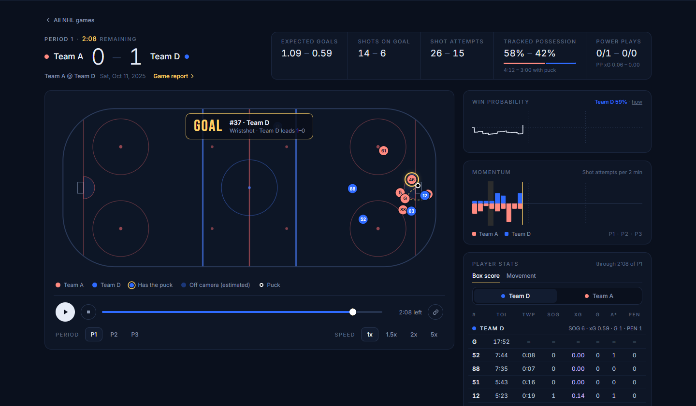
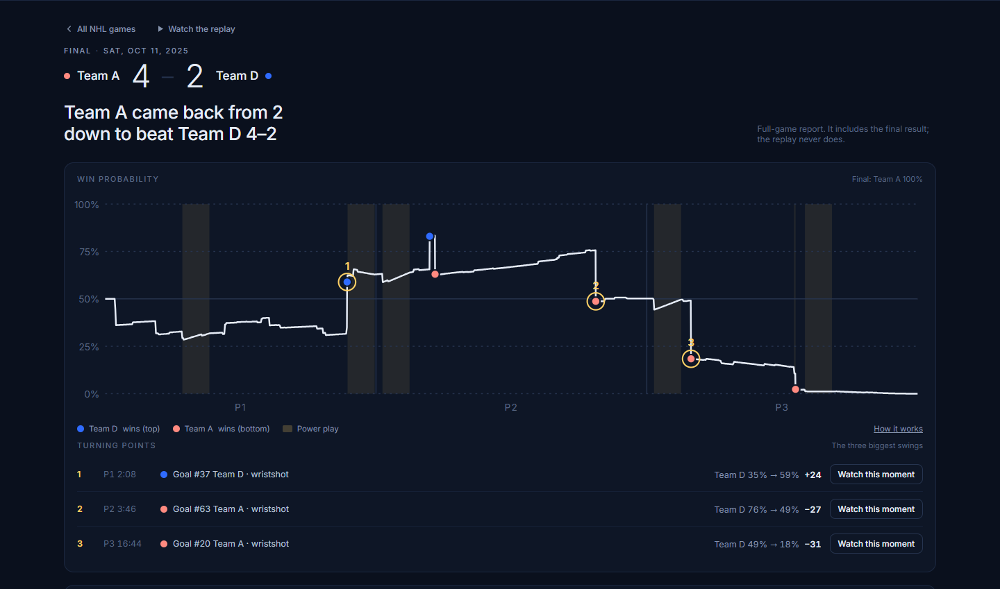
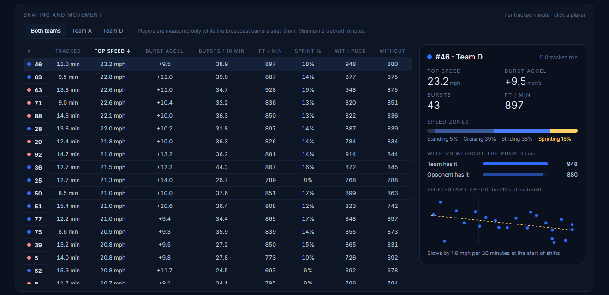
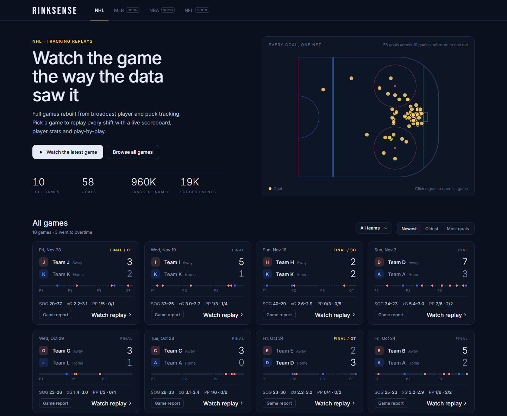

# RINKSENSE

I love sports, and I've wanted to build something like this for a while. RINKSENSE takes real player and puck tracking data from hockey games and turns it into a replay you can actually watch, with live stats, expected goals, win probability and a full report for every game.

**Live site:** [josephmossey.github.io/rinksense](https://josephmossey.github.io/rinksense/)
**Follow along on X:** [@jmanalytics](https://x.com/jmanalytics)



## Why I built it

A few reasons. I have a real passion for sports and wanted to make something that shows it. I also wanted a project that shows what I actually know about the game, not just that I can make a chart. And I wanted something real for my portfolio.

Right now it's hockey. The plan is to add more sports over time (baseball is next).

## What it does

**The replay.** Every game plays back smoothly at 1x up to 5x. The score only changes when the goal actually happens, so nothing gets spoiled. As you watch you get a live box score, expected goals (xG), possession, power plays with a countdown, momentum, win probability and a skating tab. You can copy a link to any moment and send it to someone.

**The game report.** A full breakdown after the fact: how win probability moved all game and the three biggest turning points (each one jumps you straight to that moment in the replay), a team comparison, a pass network, and a share card you can post.



**Skating and movement.** Top speed, how fast players accelerate, how many bursts they make, how much they skate with and without the puck, and whether they slow down at the start of shifts as the game goes on. Click any player for their profile.



**How it's built.** I put every model and stat on a [methods page](https://josephmossey.github.io/rinksense/methods.html): how it works, how accurate it is, and what it can't see.

## What was hard

Honestly the hardest part was getting started. It felt like a long, long process and planning it all out was overwhelming, so I just started and kept organizing as I went.

After that it was errors. The site wouldn't load, the playback was choppy and jagged at first, and players kept disappearing because the tracking comes from the broadcast camera and anyone off screen just vanishes from the data. Fixing those taught me a lot:

- The tracking jitters, and sometimes it swaps two players for a frame, which made it look like guys were skating 1,000+ mph. I had to clean every track before any speed stat meant anything.
- Players only exist in the data while they're on camera, so I use the shift chart to keep everyone who's actually on the ice visible (faded when the camera can't see them), and every skating stat is per tracked minute.
- The broadcast cuts away a lot, so nothing is allowed to slide across a camera cut.

## What I'm proud of

Taking something I'd had in my head for a long time and actually putting it out there. There's still a lot I want to add, but it's real now.



## How it works (short version)

- `scripts/preprocess.py` turns the raw CSVs into small data files the site loads. It also trains the expected goals model (logistic regression on 900 unblocked shots, tested on games it never saw, AUC 0.78) and works out power plays.
- `scripts/analytics.py` does the skating metrics, team shape, win probability, turning points and pass networks.
- The site itself is plain HTML, CSS and JavaScript with no framework, so it opens fast and runs on GitHub Pages.

To rebuild the data from the CSVs (Anaconda Prompt):

```
python -m pip install pandas numpy
python scripts/preprocess.py --src "C:\path\to\csv\folder"
```

Then open `index.html`.

## Data

Tracking and event data from Stathletes' public hockey dataset (10 games), used under its non-commercial terms. The raw CSVs aren't in this repo.

## What's next

- A cleaner pass network
- Player pages across every game
- Baseball
